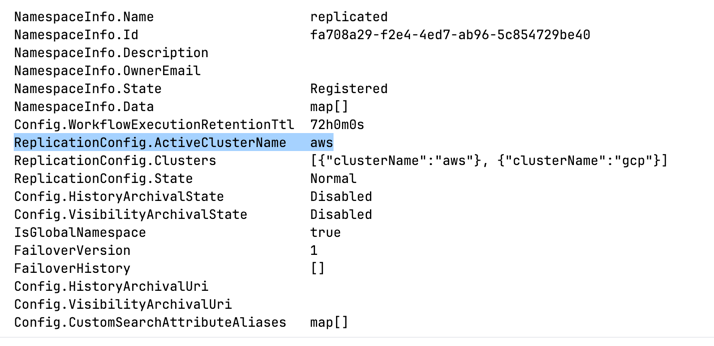
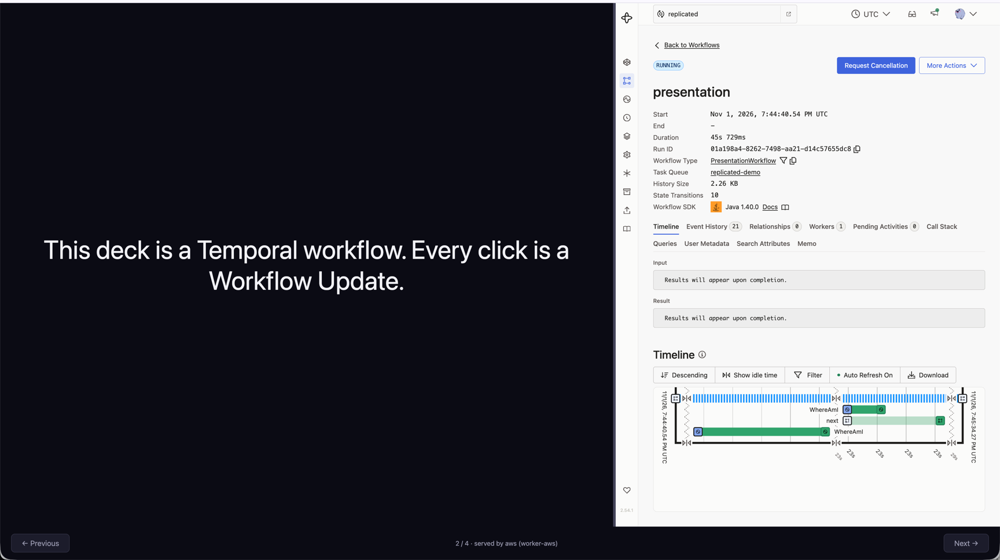

# Failover demo: the slide deck is a workflow

The presentation itself runs on Temporal. A `PresentationWorkflow` holds the current slide, and
the browser UI moves through the deck with two **Workflow Updates**, `next` and `previous`. Each
update runs an activity that records **which cloud and pod** served the slide. Fail the
`replicated` namespace over mid-talk and the next click is served by the other cloud, with no
change to the workers or the UI.

```
PresentationWorkflow.run()          started live on stage, waits until terminated
  update next()     ->  index + 1, whereAmI()  ->  Slide(2/4, "…", "gcp (failover-worker-…)")
  update previous() ->  index - 1, whereAmI()
  query  current()
```

| Piece | What it is |
|---|---|
| `src/…/PresentationWorkflow*.java` | Workflow: `next` / `previous` updates, `current` query |
| `src/…/Slides.java` | The deck text (edit the slides here) |
| `src/…/SlideActivities*.java` | Activity that reports `CLOUD` and hostname |
| `src/…/WorkerMain.java` | Worker; configured by env vars (below) |
| `src/…/UiMain.java`, `src/main/resources/index.html` | Browser UI: the slide, Previous / Next buttons (arrow keys work too), and the Temporal UI for the workflow in an iframe (`u` hides it) |
| `Dockerfile` | Multi-stage Maven build → JRE 21 image |
| `k8s/worker.yaml` | Deployment in the `temporal` namespace, pointed at the local frontend |
| `deploy-worker.sh` | Builds, pushes to ECR or Artifact Registry, applies the Deployment |

Worker env vars: `TEMPORAL_ADDRESS` (default `localhost:7233`), `TEMPORAL_NAMESPACE`
(`replicated`), `TASK_QUEUE` (`replicated-demo`), `CLOUD` (`local`). The UI also reads
`WORKFLOW_ID` (`presentation`), `PORT` (`8080`) and `TEMPORAL_UI` (`http://localhost:8233`).

The Temporal UI sends `X-Frame-Options: SAMEORIGIN`, so the deck can't iframe it from another
port. `UiMain` proxies `/temporal/*` to `TEMPORAL_UI`, which puts both on one origin. For that to
work, the Temporal UI must be served under `/temporal` (`--ui-public-path /temporal` for
`start-dev`). The iframe shows the workflow page and updates live as the clicks land.

## Prerequisites

Both clusters are deployed and connected, and the `replicated` namespace exists, as in steps 1–7
of the [global-namespace guide](../README.md). You also need Docker and `envsubst`
(`brew install gettext`).

## 1. Deploy a worker in each cloud

From the repo root, in the matching terminal:

```sh
# terminal AWS
./global-namespace/demo/deploy-worker.sh aws

# terminal GCP
./global-namespace/demo/deploy-worker.sh gcp
```

The script creates the registry repo if needed (`temporal-failover-worker` in ECR,
`temporal-demo` in Artifact Registry), builds for `linux/amd64`, pushes, switches kubectl to that
cluster, and applies `k8s/worker.yaml` with `CLOUD` set to `aws` or `gcp`. Each worker talks only
to its **local** frontend: `temporal-frontend.temporal.svc.cluster.local:7233`.

If the GKE pod is stuck in `ImagePullBackOff`, the node service account can't read Artifact
Registry:

```sh
PROJECT_NUMBER="$(gcloud projects describe "$TF_VAR_project_id" --format='value(projectNumber)')"
gcloud artifacts repositories add-iam-policy-binding temporal-demo --location "$TF_VAR_region" \
  --member "serviceAccount:${PROJECT_NUMBER}-compute@developer.gserviceaccount.com" \
  --role roles/artifactregistry.reader
```

## 2. Open the UI on the laptop

The UI talks to one frontend for the whole talk. Port-forward the AWS one:

```sh
# terminal AWS
kubectl -n temporal port-forward svc/temporal-frontend 7233:7233

# terminal UI
cd global-namespace/demo && mvn -q package
java -cp target/failover-worker.jar io.temporal.demo.failover.UiMain
open http://localhost:8080
```

Until the workflow exists, the footer shows `workflow not found`. The page keeps checking, so
slide 1 appears by itself when the workflow starts.

The iframe needs the cluster's Temporal UI under `/temporal`, reached through `TEMPORAL_UI`.
The Helm values here don't set a public path yet.

## 3. Start the workflow on stage (namespace active on AWS)

```sh
temporal workflow start --address localhost:7233 --namespace replicated \
  --task-queue replicated-demo --type PresentationWorkflow --workflow-id presentation
```

Slide 1 appears, served by `aws`, and the iframe switches to the new run. Each Next/Previous
click is one Workflow Update.

## 4. Fail over to GCP

```sh
# terminal GCP
kubectl -n temporal exec deploy/temporal-admintools -- \
  temporal operator namespace update --namespace replicated --active-cluster gcp
```

Click Next. The footer now says `served by gcp (failover-worker-…)`, and the deck is still on the
right slide. The UI is still connected to the AWS frontend. With `selected-apis-forwarding`,
`UpdateWorkflowExecution` is forwarded to the active cluster. Fail back with
`--active-cluster aws`.

Things to try:

- **Kill the active side's worker** (`kubectl scale deploy/failover-worker --replicas=0`). The
  click hangs. When you scale back up, the update completes on the same slide.
- **Start from the passive side.** With `selected-apis-forwarding`, the call is forwarded to the
  active cluster.
- **Unplanned failover.** Fail over while the active side is unreachable. Clicks that hadn't
  replicated yet are lost, and the deck may step back a slide on the new side.


## Clean up

```sh
temporal workflow terminate --namespace replicated --workflow-id presentation
kubectl -n temporal delete deployment failover-worker   # in each cluster
```


## Run locally

### One cluster

```sh
cd global-namespace/demo
mvn package
temporal server start-dev --namespace replicated --ui-public-path /temporal &
CLOUD=local java -jar target/failover-worker.jar &
java -cp target/failover-worker.jar io.temporal.demo.failover.UiMain &
temporal workflow start --namespace replicated --task-queue replicated-demo \
  --type PresentationWorkflow --workflow-id presentation
open http://localhost:8080
```

### Two replicated clusters, with failover

`local/compose.yaml` runs two Temporal 1.32.0 clusters named `aws` (frontend `:7233`) and `gcp`
(frontend `:9233`), with the same replication settings as the real ones. It also runs the Temporal
UI (`:8233`), a worker per cluster and the deck (`:8080`). A one-shot `setup` container joins the
clusters and creates the `replicated` namespace. 
State is in memory, so every `up` starts clean.


Run the demo with two clusters and wait for the containers to start:

```sh
cd local

docker compose up -d --build     # setup takes about a minute; workers and deck start after it

docker compose logs -f $(docker compose config --services | grep -vx ui) # watch the logs, except the UI
```
[compose.yaml](local/compose.yaml) invokes [setup.sh](local/setup.sh), which creates the `replicated` namespace 
and set aws as active

Verify: 
```sh
temporal operator namespace describe --address 127.0.0.1:7233 --namespace replicated   # aws

temporal operator namespace describe --address 127.0.0.1:9233 --namespace replicated   # gcp
```



Start the presentation workflow:
```sh
temporal workflow start --address 127.0.0.1:7233 --namespace replicated \
  --task-queue replicated-demo --type PresentationWorkflow --workflow-id presentation \
  --task-timeout 1s
```

Open the presentation UI:
```sh
open http://localhost:8080
```



Failover to GCP:
```sh
cd local
./failover.sh gcp                # next click is served by gcp
```

Verify:
```sh
temporal operator namespace describe --address 127.0.0.1:9233 --namespace replicated 
```

Next slide is served by gcp.


```sh
./failover.sh aws                # and back
./failover.sh                    # which cluster each side thinks is active
docker compose stop worker-gcp   # kill a worker; start it again to resume
docker compose down
```

The deck gets both frontends (`TEMPORAL_CLUSTERS=aws=aws:7233,gcp=gcp:7233`) and sends each click to
the active cluster. Server 1.32 doesn't forward Workflow Updates from the standby cluster, so
`selected-apis-forwarding` alone isn't enough.

The first click after failover takes 10–40 s. Clicks after that are instant.

## Clean up

```sh
temporal workflow terminate --namespace replicated --workflow-id presentation
kubectl -n temporal delete deployment failover-worker   # in each cluster
```


## Run locally


### Build 
```sh
cd global-namespace/demo
mvn package

```

### Run the Temporal Server
```sh
temporal server start-dev --namespace replicated --ui-public-path /temporal
```

### (new terminal) Run the worker
```sh
CLOUD=local java -jar target/failover-worker.jar 
```


### (new Terminal) Start the workflow with the presentation
```sh
temporal workflow start --namespace replicated --task-queue replicated-demo \
  --type PresentationWorkflow --workflow-id presentation
```


### (new Terminal) Start the UI / start the presentation
```sh
java -cp target/failover-worker.jar io.temporal.demo.failover.UiMain

open http://localhost:8080
```
