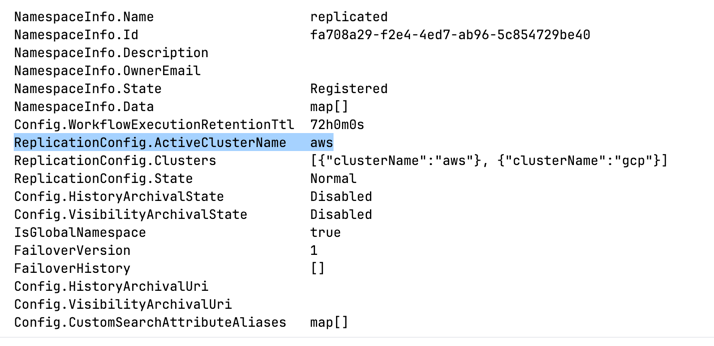

# Local failover: two replicated clusters


This is a demo is a local failover setup, where the presentation is served by a workflow running on
a replicated cluster. Failing over to the passive cluster shows how the workflow continues running and serves
the next slide from the new active cluster.


## Setup

`compose.yaml` runs two Temporal 1.32.0 clusters named `aws` (frontend `:7233`) and `gcp`
(frontend `:9233`), with the same replication settings as the real ones. It also runs the Temporal
UI (`:8233`), a worker per cluster and the deck (`:8080`). A one-shot `setup` container joins the
clusters and creates the `replicated` namespace. 
State is in memory, so every `up` starts clean.


Run everything from this folder. 

## Run

Start the clusters and wait for the containers to start:

```sh
docker compose up -d --build     # setup takes about a minute; workers and deck start after it

docker compose logs -f $(docker compose config --services | grep -vx ui) # watch the logs, except the UI
```
[compose.yaml](compose.yaml) invokes [setup.sh](setup.sh), which creates the `replicated` namespace 
and set aws as active

Verify: 
```sh
temporal operator namespace describe --address 127.0.0.1:7233 --namespace replicated   # aws

temporal operator namespace describe --address 127.0.0.1:9233 --namespace replicated   # gcp
```



Start the presentation workflow:
```sh
temporal workflow start --address 127.0.0.1:7233 --namespace replicated \
  --task-queue replicated-demo --type PresentationWorkflow --workflow-id presentation \
  --task-timeout 1s
```

Open the presentation UI:
```sh
open http://localhost:8080
```


The panel at the bottom streams the `worker-aws` and `worker-gcp` logs (the deck reads them from the
Docker socket). Keys: `→`/space next, `←` previous, `u` hides the Temporal UI, `l` hides the logs.

Failover to GCP, with the **Fail over to gcp** button next to Next, or:
```sh
./failover.sh gcp                # next click is served by gcp
```

Verify:
```sh
temporal operator namespace describe --address 127.0.0.1:9233 --namespace replicated 
```


Next slide is served by gcp.


The deck gets both frontends (`TEMPORAL_CLUSTERS=aws=aws:7233,gcp=gcp:7233`) and sends each click to
the active cluster. Server 1.32 doesn't forward Workflow Updates from the standby cluster, so
`selected-apis-forwarding` alone isn't enough.

The first click after failover takes about 2 s. `dynamicconfig.yaml` shortens matching's long
poll to 5 s.
